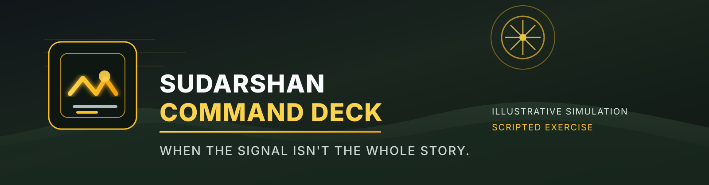
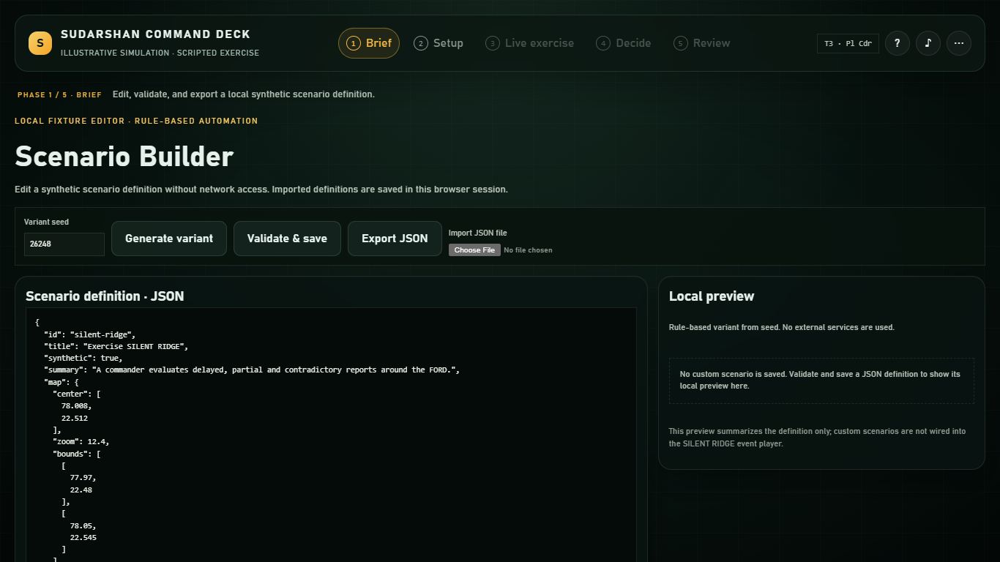
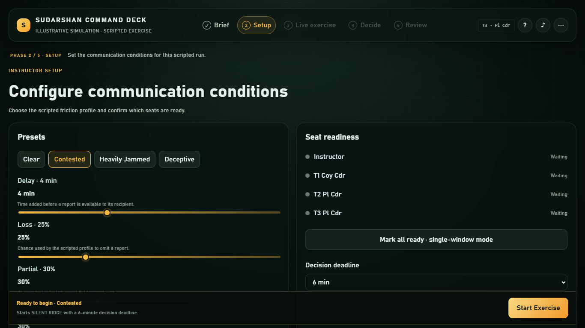
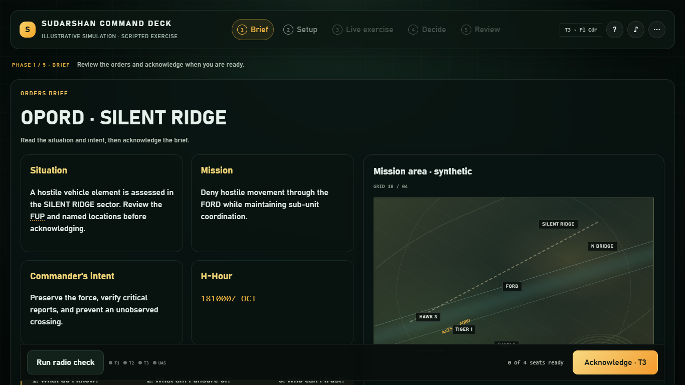
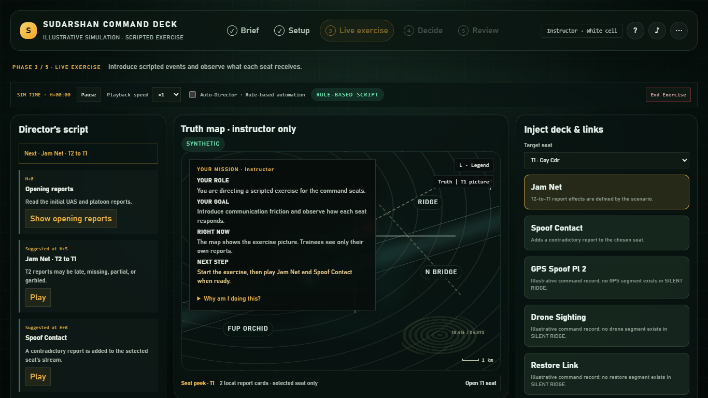
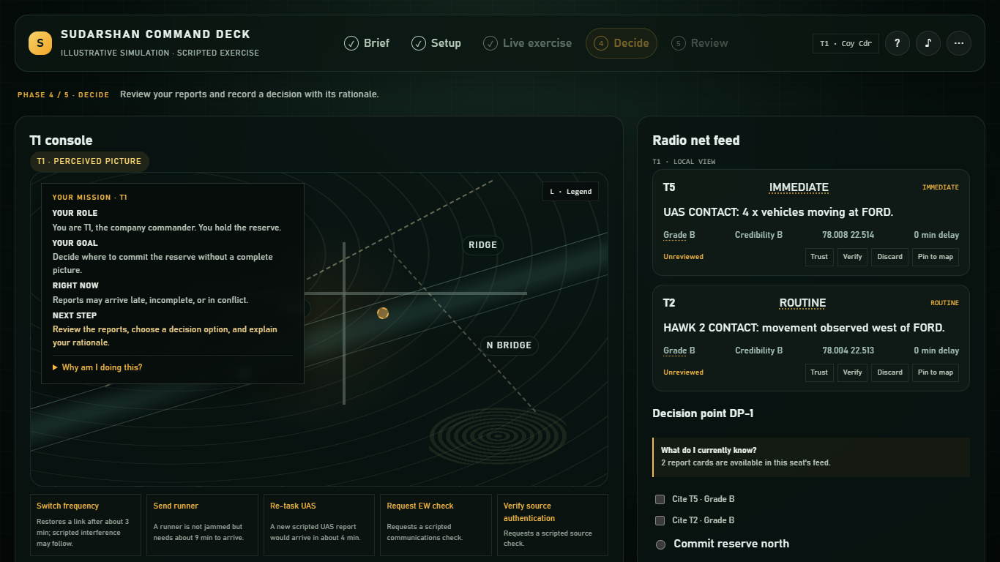
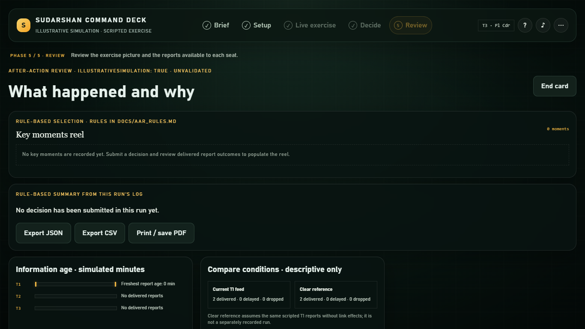
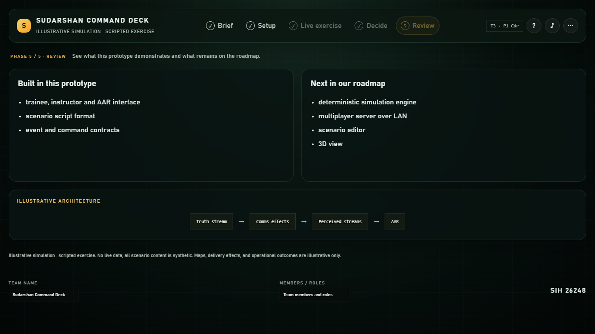
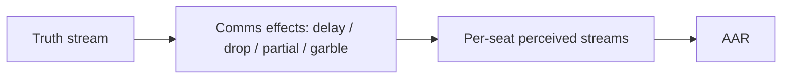
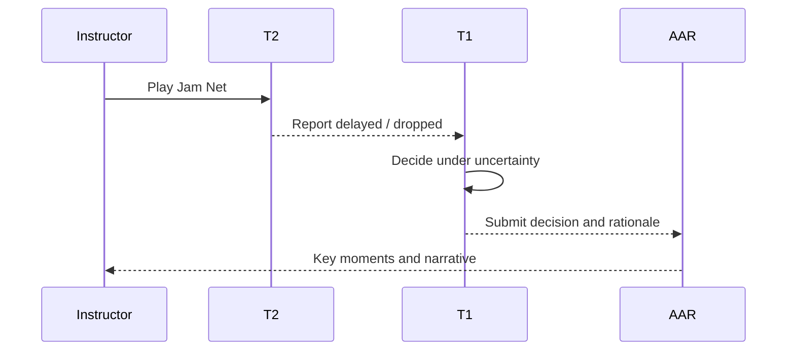

# Sudarshan Command Deck



[](https://react.dev/) [](https://www.typescriptlang.org/) [](https://vite.dev/) [](https://tailwindcss.com/) [](https://maplibre.org/) [](https://www.framer.com/motion/) [](https://vitest.dev/) [](https://playwright.dev/) [](https://github.com/obj8899/MILITARY-PS-26248-) [](https://github.com/obj8899/MILITARY-PS-26248-)

Illustrative simulation · scripted exercise. No backend, no live data.

Sudarshan Command Deck is a front-end-only, offline decision-training prototype for Smart India Hackathon problem statement 26248. It presents a degraded-communications exercise in which command seats receive delayed, dropped, partial, and contradictory reports, then decide how to act under uncertainty.

The current build focuses on SILENT RIDGE as the active scenario. The app is intentionally script-driven and local-only: it shows the interaction path, the information-age problem, and the AAR logic without a runtime backend or live data feed.

See the full project brief in [docs/PROJECT_DESCRIPTION.md](docs/PROJECT_DESCRIPTION.md).

## New: 3D battleground

Click **Enter 3D battleground** on the landing page to stand inside the SILENT RIDGE terrain: a third-person / free / top command camera, compass strip, minimap, link-bar squad panel, comms feed, report inventory, ping markers, a shrinking interference zone for the Instructor, and a scrubbable before/after review. Truth stays hidden from trainee stations until review. Offline, synthetic, hash-chained audit log, strict CSP in the production build.

Full details, controls and the security posture: [docs/BATTLEGROUND_3D.md](docs/BATTLEGROUND_3D.md).

## Screenshots

<table>
  <tr>
    <td align="center">
      <strong>Landing</strong><br>
      
    </td>
    <td align="center">
      <strong>Setup</strong><br>
      
    </td>
  </tr>
  <tr>
    <td align="center">
      <strong>Orders brief</strong><br>
      
    </td>
    <td align="center">
      <strong>Instructor Command Deck</strong><br>
      
    </td>
  </tr>
  <tr>
    <td align="center">
      <strong>T1 console</strong><br>
      
    </td>
    <td align="center">
      <strong>AAR</strong><br>
      
    </td>
  </tr>
  <tr>
    <td align="center">
      <strong>End card</strong><br>
      
    </td>
    <td align="center">
      <em>Screenshot set is captured in docs/screens/after/.</em>
    </td>
  </tr>
</table>

## How it works in 3 steps

| Step | What happens | Why it matters |
| --- | --- | --- |
| 1️⃣ Set the scene | Instructor opens the scenario, wireless profile, and brief. | The team sees the mission, terrain labels, and what is known versus uncertain. |
| 2️⃣ Deliver friction | Jam Net, spoof, delay, partial, and garble create local report effects. | Each seat perceives a different stream, which creates the decision problem. |
| 3️⃣ Decide and review | T1 chooses a course of action, then the AAR explains what changed and what was missed. | The discussion stays focused on decision quality under uncertainty, not a backend model. |

## System flow





## Folder layout

```text
MILITARY-PS-26248-
├── docs/
│   ├── PROJECT_DESCRIPTION.md
│   ├── DESIGN_SYSTEM.md
│   ├── DEMO_SCRIPT.md
│   ├── IMPLEMENTATION_STATUS.md
│   ├── PLAN.md
│   ├── screens/
│   │   ├── before/
│   │   └── after/
│   └── assets/
│       └── banner.svg
├── src/
│   ├── App.tsx
│   ├── index.css
│   ├── main.tsx
│   ├── aar/
│   ├── automation/
│   ├── builder/
│   ├── components/
│   ├── contracts/
│   ├── fixtures/
│   │   ├── copy/
│   │   └── scenarios/
│   ├── player/
│   └── ...
├── tests/
│   ├── aar.test.ts
│   ├── automation-builder.test.ts
│   ├── player.test.ts
│   ├── core-flow.e2e.spec.ts
│   └── after-screenshots.e2e.spec.ts
├── package.json
├── package-lock.json
├── vite.config.ts
├── playwright.config.ts
├── tsconfig*.json
├── index.html
├── README.md
└── THIRD_PARTY.md
```

## Feature gallery

### Instructor

- 🧭 Scenario setup and brief framing
- 📡 Jam Net and spoof inject controls
- 🗺️ Synthetic terrain and truth view
- 📝 Local run log with actor attribution

### Trainee

- 🛰️ Seat-specific feed views for T1/T2/T3
- 🧩 Triage and report verification controls
- 🧠 Decision submission with rationale and cited basis
- ⚠️ Contradictory or delayed report highlighting

### AAR

- 📚 Rule-based key moments reel
- ⏱️ Information-age timeline marks
- 🧾 JSON/CSV export and browser print flow
- 🧭 Narrative comparison against the scripted truth stream

### Automation

- ⚙️ Local Auto-Director beats and pause control
- 🤖 Rule-based advisor suggestions
- 🏗️ Scenario-builder validation and deterministic delay variants
- 🔎 Structural checks for local scenario definitions

## Try it

### Local run

```bash
npm install
npm run dev
npm run build
```

### Exact two-minute demo path

1. Open the landing page and click `Begin exercise`.
2. Choose the `Contested` profile if needed, then click `Mark all ready · single-window mode`.
3. Start the exercise, review the brief, and click `Acknowledge`.
4. On Instructor, play `Jam Net`, then `Spoof Contact`.
5. Open `⋯` and switch to `T1`.
6. Review the reports, verify the relevant source, and submit the decision.
7. Review the AAR, step through key moments, then open the end card.

This is the intended short rehearsal path described in the project docs.

## Built vs Roadmap

| Built in this prototype | Next in our roadmap |
| --- | --- |
| Local SILENT RIDGE exercise and brief flow | A full deterministic event player for more complex scenario timing |
| CSS terrain map and synthetic labels | Map or scenario data rendered from a richer fixture owner model |
| Instructor inject deck and run-log UI | More complete branch execution and deadline interactions |
| Seat-specific T1/T2/T3 feed views | Isolated cross-window or multi-seat synchronization |
| Rule-based AAR narrative and export controls | A stronger, authoritative event log and replay flow |
| Local scenario builder with validation and seeded variants | Executable custom scenario support, beyond preview only |
| Browser-only, offline front-end experience | Any future runtime service or live backend architecture |

## Scenario scripts and notes

<details>
  <summary>Scenario scripts</summary>

The active scenario is SILENT RIDGE. It is delivered as a local JSON fixture and supports script-driven communication friction, delayed reports, contradictory contact reports, and a local decision review path. The project docs explicitly describe the current implementation as illustrative and scripted, not a full operational simulator.

The exercise focuses on report age, source grade, contradiction, and the command decision under uncertainty. The Instructor can play Jam Net and Spoof Contact to create friction. T1 sees a filtered feed and must decide with incomplete information. The AAR then assembles local narrative moments from run-log and feed state.
</details>

<details>
  <summary>Folder layout and repo notes</summary>

This repository keeps the prototype simple and front-end-only. Most of the app logic is in `src/App.tsx`, while scenario text and report fixtures live under `src/fixtures/`. The documentation files under `docs/` describe the design system, demo path, project brief, and implementation status. The tests cover the core flow, AAR logic, player logic, and visual screenshot capture.
</details>

<details>
  <summary>Tests and verification</summary>

The project includes Vitest unit tests, Playwright end-to-end checks, and screenshot capture for the after state. The project docs are intentionally candid: the app demonstrates the interaction model and local rule-based AAR, but it is not a full deterministic event engine or a shared multi-seat simulation system.
</details>

## Credits and project info

- Project description: [docs/PROJECT_DESCRIPTION.md](docs/PROJECT_DESCRIPTION.md)
- Credits: The app includes editable end-card fields for team name and members in the browser. The repository itself does not include a fixed project-team name or member list in source.
- License: No repository-level license file was found in the root of this project.

## Animated GIF or video note

No animated GIF or video is included under `docs/` at this time. To record one, open the app in a browser, run `npm run dev`, follow the two-minute click path above, and capture a screen recording at 1080p with a short narration on the decision and AAR flow.

## Missing screenshots or GIFs to add

- No missing screenshot placeholders are required; the required screens are present under `docs/screens/after/`.
- No GIF or video was found in `docs/`; record one if you want a motion preview alongside the static screenshots.
